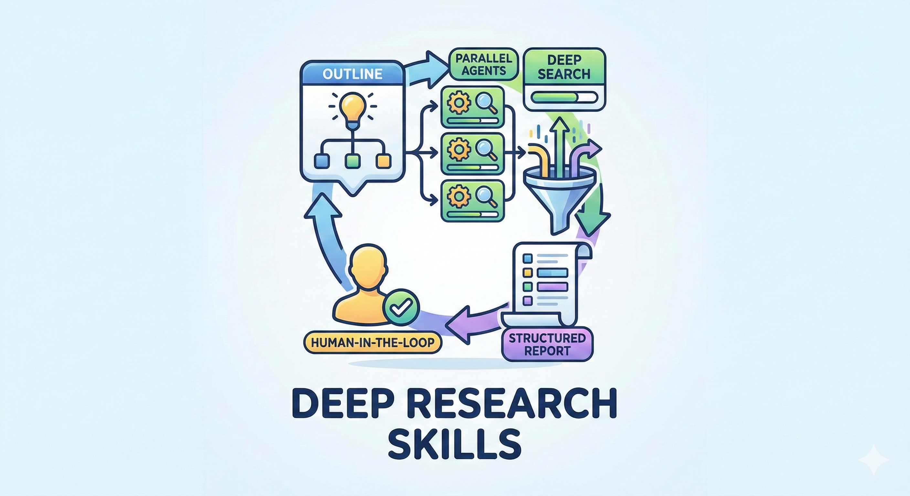

# Deep Research Skill for Claude Code / OpenCode / Codex

[English](README.md) | [中文](README.zh.md)

> If you find this project helpful, please give it a star! :star:

> Inspired by [RhinoInsight: Improving Deep Research through Control Mechanisms for Model Behavior and Context](https://arxiv.org/abs/2511.18743)

A structured, human-in-the-loop research workflow skill for Claude Code, OpenCode, and Codex. It helps turn broad research questions into clear, actionable plans and organized reports.

The workflow has two main stages. First, it generates a customizable research outline with specific topics to investigate and fields to collect. You can review and refine the outline—adding or removing research items and fields—before the investigation begins. Next, the skill researches each item using web search and, where supported, parallel agents, then organizes the findings into structured data. You can turn those results into a polished Markdown report with a table of contents.

By keeping you in control of the outline and research scope, the workflow makes complex investigations easier to manage and adapt. It is suitable for academic literature reviews, technical evaluations, market analysis, and due diligence, and supports both English and Chinese workflows.



## Use Cases

- **Academic Research**: Paper surveys, benchmark reviews, literature analysis
- **Technical Research**: Technology comparison, framework evaluation, tool selection
- **Market Research**: Competitor analysis, industry trends, product comparison
- **Due Diligence**: Company research, investment analysis, risk assessment

## Installation

```bash
git clone https://github.com/Weizhena/deep-research-skills.git
cd deep-research-skills
```

### Claude Code
```bash
# English version
cp -r skills/research-en/* ~/.claude/skills/

# Chinese version
cp -r skills/research-zh/* ~/.claude/skills/

# Required: Install agent and modules
cp agents/web-search-agent.md ~/.claude/agents/
cp -r agents/web-search-modules ~/.claude/agents/

# Required: Install Python dependency
pip install pyyaml
```

### OpenCode (default: gpt-5.4)
```bash
# Skills (same as Claude Code)
cp -r skills/research-en/* ~/.claude/skills/   # or research-zh for Chinese

# Required: Enable web search for current shell
export OPENCODE_ENABLE_EXA=1

# Optional: make it permanent
echo 'export OPENCODE_ENABLE_EXA=1' >> ~/.bashrc
source ~/.bashrc

# Required: Install agent and modules
cp agents/web-search-opencode.md ~/.config/opencode/agents/web-search.md
cp -r agents/web-search-modules ~/.config/opencode/agents/

# Required: Install Python dependency
pip install pyyaml
```

> **Important**: In OpenCode, ANY model's websearch requires `OPENCODE_ENABLE_EXA=1`. A plain `export` only affects the current shell; writing it to `~/.bashrc` makes it persistent. Without it, you only get `web fetch`, which is weaker for the deep research phase.

### Codex
```bash
# English version
mkdir -p ~/.codex/skills ~/.codex/agents
cp -r skills/research-codex-en/* ~/.codex/skills/

# Chinese version
mkdir -p ~/.codex/skills ~/.codex/agents
cp -r skills/research-codex-zh/* ~/.codex/skills/

# Required: Install web researcher agent and modules
cp agents-codex/web-researcher.toml ~/.codex/agents/
cp -r agents-codex/web-search-modules ~/.codex/agents/

# Required: Install Python dependency
pip install pyyaml
```

Add or update `~/.codex/config.toml` using either method below:

**Option A: Automatic script**

```bash
cd deep-research-skills
bash scripts/install-codex.sh
```

**Option B: Manual edit**

```toml
suppress_unstable_features_warning = true

[features]
multi_agent = true
default_mode_request_user_input = true

[agents.web_researcher]
description = "Use this agent when you need to research information on the internet, particularly for debugging issues, finding solutions to technical problems, or gathering comprehensive information from multiple sources. This agent excels at finding relevant discussions. Use when you need creative search strategies, thorough investigation, or compilation of findings from multiple sources."
config_file = "agents/web-researcher.toml"
```

## Commands

> **Claude Code 2.1.0+**: Direct `/skill-name` trigger is now supported!
>
> **Older versions**: Use `run /skill-name` format instead.
>
> **Codex**: You can trigger these skills from `/skills` -> `List Skills`, or ask naturally, for example `Use the research skill to build an outline for AI Agent Demo 2025`.

| Command (2.1.0+) | Description |
|------------------|-------------|
| `/research` | Generate research outline with items and fields |
| `/research-add-items` | Add more research items to existing outline |
| `/research-add-fields` | Add more field definitions to existing outline |
| `/research-deep` | Deep research each item with parallel agents |
| `/research-report` | Generate markdown report from JSON results |

## Workflow & Example

> **Example**: Researching "AI Agent Demo 2025"

### Phase 1: Generate Outline
```
/research AI Agent Demo 2025
```
💡 **What will happen**: Tell it your topic → It creates a research list for you

**You get**: A list of 17 AI Agents to research (ChatGPT Agent, Claude Computer Use, Cursor, etc.) + what info to collect for each

### (Optional) Not satisfied? Add more
```
/research-add-items
/research-add-fields
```
💡 **What will happen**: Add more research items or field definitions

### Phase 2: Deep Research
```
/research-deep
```
💡 **What will happen**: AI automatically searches the web for each item, one by one

**You get**: Detailed info for each Agent (company, release date, pricing, tech specs, reviews...)

### Phase 3: Generate Report
```
/research-report
```
💡 **What will happen**: All data → One organized report

**You get**: `report.md` - A complete markdown report with table of contents, ready to read or share

## Need Help?

If you have questions, ask Claude Code, OpenCode, or Codex to explain this project:
```
Help me understand this project: https://github.com/Weizhena/deep-research-skills
```

## References

- RhinoInsight: Improving Deep Research through Control Mechanisms for Model Behavior and Context

## License

MIT
